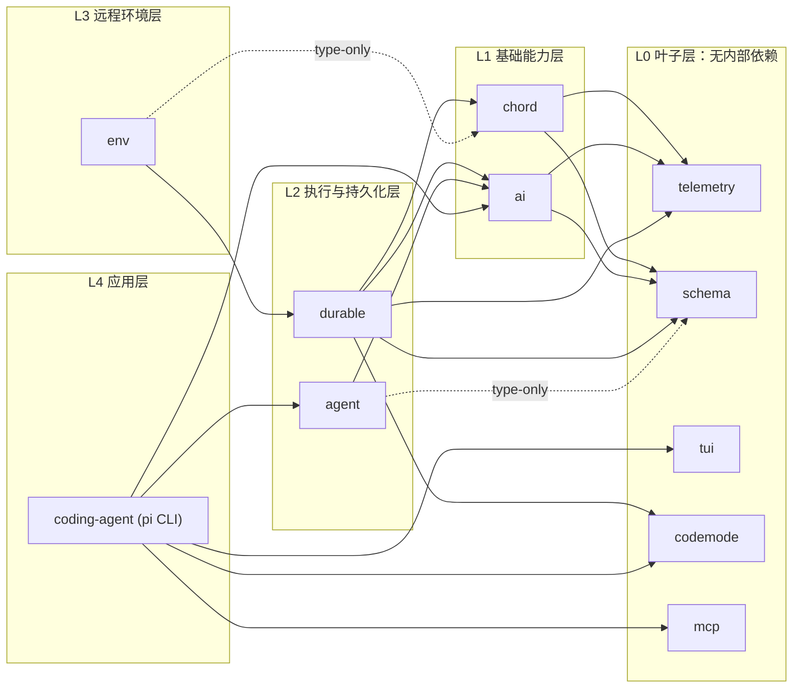

# 实践课2：组织建仓与源码分析

**姓名拼音：** （待填）
**学号：** （待填）
**小组组织：** https://github.com/aaa-course-project
**本人重点分析模块：** `packages/agent`（Agent 执行层）

---

## 一、源码获取

### 1.1 小组仓库

小组组织内的课程仓库：

```
https://github.com/aaa-course-project/pi-hunnu-2026
```

本人实际 clone 地址：

```
https://github.com/aaa-course-project/pi-hunnu-2026.git
```

### 1.2 本地 clone 后的仓库信息

在仓库根目录执行 `Get-Location`、`git remote -v`、`git branch --show-current`、`git rev-parse HEAD`、`git status --short` 的结果：

```text
Path
----
D:\projects\study\pi-hunnu-2026

origin  https://github.com/aaa-course-project/pi-hunnu-2026.git (fetch)
origin  https://github.com/aaa-course-project/pi-hunnu-2026.git (push)

main

c3cc91632d0a1950fb122605b190233f2aa0006e
```

- 当前分支：`main`
- 完整提交编号：`c3cc91632d0a1950fb122605b190233f2aa0006e`
- 提交标题：`feat(p2): ordered file pills in the composer, files marked in place for the model`
- 提交时间：2026-11-15 01:27:34 +0100

要点：`origin` 指向的是**小组组织** `aaa-course-project` 下的仓库，而不是教师组织 `hunnuOpenSourceSoftware2026`，也不是个人账号。仓库属于本次课程要求的小组组织。

> 说明：本机 `hosts` 把 `github.com` 及其相关域名全部解析到 `127.0.0.1`，无法直连 GitHub。本次通过镜像入口完成 clone，`origin` 因此记录为镜像地址。教师组织的参考地址为 `https://github.com/hunnuOpenSourceSoftware2026/pi-hunnu-2026`。

### 1.3 源码目录结构

```text
pi-hunnu-2026/
├── package.json          # 根工作区定义与 build 脚本
├── package-lock.json     # 锁定依赖版本
├── tsconfig.json         # 只服务 npm run check（noEmit，paths 指向 src）
├── tsconfig.base.json    # 所有子包 tsconfig.build.json 的公共基础
├── pi-test.bat / .ps1 / .sh   # 运行本地源码的入口
├── packages/
│   ├── telemetry/  schema/  chord/  tui/  codemode/  mcp/
│   ├── ai/  durable/  env/  agent/  coding-agent/
│   └── evals/            # 不参与根 build（无 build 脚本）
└── apps/
    └── p2/  p2-mac/  p3/ # 也不参与根 build
```

---

## 二、模块分析

### 2.1 构建顺序

根 `package.json` 的 `scripts.build` 是一个串行 shell 链（无 turbo/nx/lerna 等编排器）：

```text
telemetry → schema → chord → tui → codemode → mcp → ai
          → durable → env → agent → coding-agent
```

### 2.2 模块分析表

| 子文件夹 | npm 包名 | 代码主要实现什么功能 | 本模块 build 执行什么、生成什么 | 直接依赖的内部模块 | 依据文件或代码位置 |
|---|---|---|---|---|---|
| `telemetry` | `@earendil-works/pi-telemetry` | 厂商中立的遥测契约：回调式 `TelemetryContext`/`TelemetrySpan`、`NOOP_TELEMETRY_CONTEXT`、内存适配器、计数器与直方图、`defineTelemetrySchema`。只定义契约，不含导出器、不绑定后端 | `tsc -p tsconfig.build.json`，纯 tsc 逐文件编译，不打包；生成 `dist/index.js`、`dist/render.js`、`dist/testing/index.js` 及 `.d.ts`/`.map` | 无 | `packages/telemetry/package.json:8-24,31`；`tsconfig.build.json:4-7`；`src/index.ts:1-40` |
| `schema` | `@earendil-works/pi-schema` | JSON Schema（2020-12 与 draft 7）构建器 + `compile()`：把 schema 一次性编译成普通闭包，不使用 `eval`，可在严格 CSP 下运行；错误按 JSON Pointer 报路径 | 同上，纯 tsc；生成 `dist/index.js`、`dist/formats/index.js` | 无 | `packages/schema/package.json:8-19,29`；`src/index.ts:1-2,35-36` |
| `chord` | `@earendil-works/chord` | 跨进程对象运行时：对象类型即契约（用 pi-schema 描述）、facet/插件热重载、文档与 store、HTTP/workers、web/react/tui 客户端面 | 纯 tsc；生成 `dist/index.js` 及 25 个子路径入口（`dist/context/index.js`、`dist/node/http/index.js`、`dist/web/index.js` 等）。esbuild/react/ws 是运行时按需加载的可选 peer，不参与本包 build | `schema`、`telemetry` | `packages/chord/package.json:8-139,151,176-191`；`src/contracts/schema.ts:5-21`；`src/context/index.ts:1` |
| `tui` | `@earendil-works/pi-tui` | 终端 UI 框架：差分渲染、主屏/备用屏双实现、组件库（Editor/Markdown/ScrollView）、按键与主题、内联图片 | 纯 tsc；按 `rootDir: ./src` 镜像整棵源码树到 `dist/**`。**原生剪贴板模块不在 build 内**，由独立的 `build:native:*` 生成 | 无 | `packages/tui/package.json:9-12`；`tsconfig.build.json:7` |
| `codemode` | `@earendil-works/pi-codemode` | 在 QuickJS（编译为 WASM）里执行模型写的 JS，唯一能力是调用注入的 tools；嵌套工具调用不进 LLM 上下文；提供 Node worker / Cloudflare DO / 内联三种 sandbox | 纯 tsc；生成 `dist/index.js`、`dist/declarations.js`、`dist/source.js`、`dist/portable.js`、`dist/cloudflare.js`、`dist/runtime/worker.js` | 无 | `packages/codemode/package.json:8-39,46`；`tsconfig.build.json:1-11` |
| `mcp` | `@earendil-works/pi-mcp` | 独立 MCP 客户端：JSON-RPC 协议层、stdio / Streamable HTTP / pipe / 内存四种传输、OAuth、工具名与输出限长 | 纯 tsc；生成 `dist/index.js`、`dist/oauth/index.js`、`dist/testing/index.js` | 无 | `packages/mcp/package.json:8-24,34`；`src/index.ts:1-14`；`README.md:3` |
| `ai` | `@earendil-works/pi-ai` | 统一 LLM API：各 provider/api 实现、模型目录、认证与凭据、流式输出、token 与成本、工具声明与参数校验（校验走 pi-schema） | **codegen + tsc + 数据拷贝**：先 `node catalog/generate.ts --strict` 生成 `src/models.generated.ts` 与 `src/providers/data/`，再 tsc，最后用 `scripts/package-files.mjs` 把 JSON 数据拷进 `dist/providers`。首次构建需联网取模型目录数据 | `schema`、`telemetry` | `packages/ai/package.json:4-65,76-77`；`catalog/generate.ts:246,262-263` |
| `durable` | `@earendil-works/pi-durable` | 持久化 agent harness：会话轮次与工具调用先落存储再展示，进程中断可续跑并重试；含 compaction、任务图、文档、存储适配（memory/indexeddb/jsonl/sqlite）、codemode 与 tool-search 集成 | 纯 tsc；生成 `dist/index.js` 及 `dist/env/*`、`dist/codemode/index.js`、`dist/storage/**`、`dist/tools/index.js`、`dist/tool-search/index.js` 等子路径 | `chord`、`ai`、`schema`、`telemetry`、`codemode` | `packages/durable/package.json:8-123,133`；`src/session/session.ts:1-4`；`src/harness/harness.ts:5`；`src/codemode/codemode.ts:41,49` |
| `env` | `@earendil-works/pi-env` | SSH 远程执行环境：远端 Rust daemon + 帧协议 `Connection`，`RemoteExecutionEnv` 实现 Durable 的 `ExecutionEnv`；提供进程、终端、文件监听、列目录 | 纯 tsc，仅一个公开入口 `dist/index.js`。Rust daemon 由独立的 `build:daemon`（cargo）构建，**不在 `npm run build` 内** | `durable`（运行时）、`chord`（仅类型） | `packages/env/package.json:8-14,26-27`；`src/list-files.ts:1,13`；`src/index.ts:1-33` |
| `agent` | `@earendil-works/pi-agent-core` | **本人重点分析模块。** 有状态 agent 核心：agent loop、工具执行、事件流、可替换的 `streamFn` 传输抽象、proxy。只依赖 pi-ai 的模型层类型和流函数，不关心具体 provider | 纯 tsc；`exports` 只有 `"."`，生成单入口 `dist/index.js` + `dist/index.d.ts` | `ai`（运行时）、`schema`（仅类型 `import type { Static }`） | `packages/agent/package.json:8-14,21,27`；`src/agent.ts:1-14`；`src/types.ts:17`；`src/agent-loop.ts` |
| `coding-agent` | `@earendil-works/pi-coding-agent` | pi CLI 本体：会话管理与持久化、内置工具（read/bash/edit/write）、interactive/print/json/rpc 四种模式、扩展系统、MCP 与 codemode 接入、skill 与 theme | **两段式**：`build:unbundled` = tsc + `package-files.mjs executable`（给 `dist/cli.js`、`dist/rpc-entry.js` 加执行位）+ `copy-assets`；随后 `build-coding-agent-bundle.mjs` 用 **esbuild** 打包（`bundle:true`、`splitting:true`、`target:node22.19`）。生成 `dist/cli.js`、`dist/modes/**`、`dist/core/**`，以及打包产物 `dist/bundle/cli.js`（`bin: pi` 的启动壳）、`dist/bundle/cli-runtime.js`、`dist/bundle/chunks/*` | `agent`、`ai`、`tui`、`codemode`、`mcp` | `packages/coding-agent/package.json:9-22,33-36`；`scripts/build-coding-agent-bundle.mjs:78-104,140-152`；`src/core/sdk.ts:2` |

补充：`packages/evals`、`apps/p2`、`apps/p3` 没有 `build` 脚本，不参与根 build；`apps/p2-mac` 连 `package.json` 都没有。因此根 build 覆盖的是 **11 个包**，不是全部 workspace。

### 2.3 模块层级与依赖关系图

箭头方向统一为**使用方 → 被依赖方**。实线为运行时依赖，虚线为仅类型依赖。



**层级划分依据（按“离应用的距离”而非按构建顺序排）：**

- **L0**：`src/` 内没有任何 `@earendil-works/*` 的值导入，是真正的叶子。逐个 grep 确认，`tui` 里只有 `Symbol.for("@earendil-works/pi-tui/...")` 字符串，`codemode`/`mcp` 只在注释里提到别的包名。
- **L1**：只依赖 L0 的通用能力。`chord` 用 schema 描述对象契约、用 telemetry 上报；`ai` 用 schema 校验工具参数、用 telemetry 记录调用。
- **L2**：`durable` 与 `agent` 互不依赖，但都建立在 L1 之上。`durable` 是持久化执行层，`agent` 是单次会话的循环层。
- **L3**：`env` 实现 `durable` 的 `ExecutionEnv` 接口，是它的上层适配。
- **L4**：`coding-agent` 把上述能力组装成 CLI 产品，处在图的汇聚点。

图中的边只保留有代码依据的直接依赖；`devDependencies` 里没有任何内部包，所以不存在“开发依赖”类型的边；唯一的内部 peer 情况也不存在（`chord` 的 `esbuild`/`react`/`ws` 是外部可选 peer）。`agent → schema` 与 `env → chord` 两条是声明为运行时依赖、但代码里只有 `import type` 的类型边，已用虚线区分。

### 2.4 三个问题的回答

#### 问题 1：根目录与子模块中的 `npm run build` 分别读取什么配置、执行什么工作？

**根目录**：根 `package.json` 的 `build` 是一串写死的 `cd packages/xxx && npm run build && ...`，它自己**不读任何 tsconfig、不编译任何文件**，只负责按顺序进子包目录并转发。`&&` 保证前一步成功才继续，任一步失败整条链立刻停止。`build:offline` 链条完全相同，只有 `ai` 那一步换成 `build:offline`（跳过 codegen）。根 `devDependencies` 里只有 biome/esbuild/husky/pnpm/typescript/yaml，没有 turbo/nx/lerna，所以不存在任务编排器。

**子模块**：每个包读自己的 `tsconfig.build.json`，它 `extends ../../tsconfig.base.json` 并覆盖 `outDir: ./dist`、`rootDir: ./src`、`include: ["src/**/*.ts"]`。`tsconfig.base.json` 决定编译语义：`target ES2024`、`module Node16`、`strict`、`declaration + declarationMap + sourceMap`、`erasableSyntaxOnly`、`verbatimModuleSyntax`、`rewriteRelativeImportExtensions`（源码里写 `.ts` 后缀，产物改写成 `.js`）。因此标准动作就是 **tsc 逐文件 emit 出 JS + `.d.ts` + `.map`**，不打包、不做 tree-shaking。

三个例外必须在报告里区分开：

- `ai`：先 codegen 再 tsc 再拷数据。codegen 会**写回源码树**（`src/models.generated.ts`、`src/providers/data/`），所以“build 只写 dist”对这个包不成立。
- `coding-agent`：tsc 之后还要有一次 esbuild 打包，才产出 `dist/bundle/cli.js`。
- `tui` / `env`：原生部分（`.node` 剪贴板模块、Rust daemon）分别由 `build:native:*` 和 `build:daemon` 构建，**不在** `npm run build` 里。

还需要特别区分**两套 tsconfig 的分工**：根 `tsconfig.json` 只服务 `npm run check` 的 `tsc --noEmit`，它把 `@earendil-works/*` 的 `paths` 指向 `packages/*/src/*.ts`，走源码解析、不需要先 build；而各包的 `tsconfig.build.json` 把 `paths` 指向上游的 `dist/*.d.ts`，走产物解析、必须先 build 上游。这是整个仓库构建行为的核心机制。

#### 问题 2：构建顺序和模块依赖有什么关系？相邻构建的模块是否一定互相依赖？

**关系**：构建顺序是真实依赖 DAG 的一个**合法拓扑序**——每个包的所有内部依赖都排在它前面。`chord`(第3) 需要 `schema`(2)、`telemetry`(1)；`ai`(7) 需要 `schema`、`telemetry`；`durable`(8) 需要 `chord`(3)、`codemode`(5)、`ai`(7)；`env`(9) 需要 `durable`(8)；`agent`(10) 需要 `ai`(7)；`coding-agent`(11) 需要 `agent`(10)、`ai`、`tui`(4)、`codemode`(5)、`mcp`(6)。

**机制上为什么必须这样**：下游的 `tsconfig.build.json` 把 `paths` 硬编码到上游的 `dist`，例如 `packages/agent/tsconfig.build.json:6-7` 指向 `../ai/dist/index.d.ts`，`packages/coding-agent/tsconfig.build.json:6-11` 指向 `../agent/dist/index.d.ts`、`../tui/dist/*.d.ts`。没被 `paths` 覆盖的跨包导入通过 `node_modules/@earendil-works/*` 的 workspace junction 解析到目标包的 `types`，同样指向 `dist/index.d.ts`。上游没先构建，下游 tsc 直接报找不到模块。打包脚本把这一前提写成了断言：`scripts/build-coding-agent-bundle.mjs:140-152`，缺文件就抛 `Bundle input is missing: ... Build the workspace packages first.`

**“相邻”不等于“依赖”**。10 组相邻对里只有 4 组是真边：

| 相邻对 | 是否存在内部依赖 |
|---|---|
| telemetry → schema | 否（两个互不依赖的叶子） |
| schema → chord | 是 |
| chord → tui | 否（`chord/src/tui/terminal.ts:3` 只有一句注释提到 pi-tui） |
| tui → codemode | 否 |
| codemode → mcp | 否（`mcp/README.md:3` 自述不依赖其他 pi 包） |
| mcp → ai | 否 |
| ai → durable | 是 |
| durable → env | 是 |
| env → agent | 否 |
| agent → coding-agent | 是 |

所以这个顺序的性质是“叶子先进、应用最后”的粗粒度线性化（同时也大致符合包体积由小到大），并不是一条相邻依赖链。拓扑序也不唯一：`tui`、`codemode`、`mcp` 三者的相对位置可以任意交换，只要都排在 `coding-agent` 之前即可。

#### 问题 3：选一条涉及至少三个模块的依赖路径，说明这些模块如何分工

选择路径：**coding-agent → agent → ai → schema**（4 个模块，4 条边均经代码核实）。

| 模块 | 分工 |
|---|---|
| `schema` | 只做“JSON Schema → 校验闭包”一件事。`compile()` 把 schema 编译成普通闭包，不用 `eval`；构建器 `obj/str/opt/...` 返回带类型的普通 JSON Schema 对象，`Static<typeof X>` 直接推出 TS 类型 |
| `ai` | 把“模型能力”包成统一 API，并用 schema 把工具声明与参数校验做成可编译的契约（`src/utils/validation.ts:1-2` 同时 import `compile` 与 `formats`）。对外提供 provider/api 实现、模型目录、流式事件。对 schema 是运行时依赖，校验器要真跑 |
| `agent` | 不关心是哪个 provider，只消费 pi-ai 的消息/模型类型与流函数（`src/agent.ts:1-14`）。`agent-loop.ts` 负责循环与工具执行，`stream-fn.ts` 提供可替换的默认 `streamFn`，从而把“一次对话怎么推进”和“怎么连模型”解耦 |
| `coding-agent` | 把内核做成 CLI 产品：`src/core/sdk.ts:2,4` 用 `Agent`/`setDefaultStreamFn` 配合 pi-ai 的 `streamSimple` 组装 SDK；`AgentSession` 管会话与持久化；`src/modes/*` 提供前端；`src/core/tools/**` 提供内置工具 |

一句话概括分工：**schema 判定“值是否合法” → ai 负责“如何向模型发请求并校验其工具参数” → agent 负责“如何循环、调工具、发事件” → coding-agent 负责“会话、工具集、终端界面与 CLI 入口”**。

构建上这条路径被强制成一条链：`coding-agent` 需要 `agent/dist`，`agent` 需要 `ai/dist`，`ai` 通过 junction 需要 `schema/dist`，任一段缺失下游直接编译失败；最后由 esbuild 从 dist 出发把 agent/ai/tui/codemode/mcp 全部内联进 `dist/bundle/`。

---

## 三、与实验文档假设不符、需要说明的发现

分析过程中发现几处与常见假设不一致的地方，按实际代码记录：

1. **“相邻构建即互相依赖”不成立**：10 组相邻对中 6 组没有依赖关系（见上表）。
2. **“根 build 覆盖全部 workspace”不成立**：只覆盖 11 个包；`packages/evals`、`apps/p2`、`apps/p3` 都没有 `build` 脚本。
3. **“build 只写 dist”对 `ai` 不成立**：`ai` 的 build 会写回 `src/models.generated.ts` 和 `src/providers/data/`。
4. **“tui 的 build 产出原生模块”不成立**：`tui` 的 build 只跑 tsc，`.node` 产物来自独立的 `build:native:*`；同理 `env` 的 Rust daemon 由 `build:daemon` 构建。
5. **“根 build 会做类型检查”不成立**：根 build 只做逐包 emit；全仓类型检查是 `npm run check` 的 `tsc --noEmit`，而且它读的 `paths` 指向 `src`，与 build 指向 `dist` 完全相反。

---

## 四、提交信息

- 个人报告仓库：`https://github.com/Yes-ysh/pi-hunnu-2026-assignments`
- 小组代码仓库：`https://github.com/aaa-course-project/pi-hunnu-2026`
