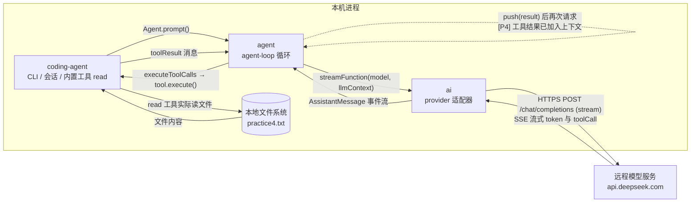

# 实践课4：Pi Agent 的模型调用与运行流程

**姓名拼音：** yangsihui
**学号：** 202430224005
**小组仓库：** https://github.com/aaa-course-project/pi-hunnu-2026
**提交 commit：** `c3cc91632d0a1950fb122605b190233f2aa0006e`（本地在其上修改，未提交回小组仓库）

---

## 任务一 给 Agent 循环加两行日志

修改文件：`packages/agent/src/agent-loop.ts`

本组成员仓库的实际行号与教师演示版本**完全一致**（第 284 行、第 412 行），无需搜索。

### 1.1 在模型调用前打印日志

原第 412 行 `const response = await streamFunction(...)`，在它**上方**插入一行。修改后：

```ts
	// Resolve API key (important for expiring tokens)
	const resolvedApiKey =
		(config.getApiKey ? await config.getApiKey(config.model.provider) : undefined) || config.apiKey;

	console.error("[P4] Agent 即将请求模型"); // 新增
	const response = await streamFunction(config.model, llmContext, {
		...config,
		apiKey: resolvedApiKey,
		identity: mergeClientIdentity(DEFAULT_AGENT_IDENTITY, config.identity),
		signal,
	});
```

插入后该行落在第 413 行。`streamAssistantResponse()` 在每次把当前上下文交给模型调用函数前都会走到这里。

> **截图 S1：** 需自行截取编辑器中的文件名、行号，以及新增的 `[P4] Agent 即将请求模型` 和紧随其下的 `await streamFunction(...)`。

### 1.2 在工具结果加入上下文后打印日志

原第 284 行 `currentContext.messages.push(result);`，在它**下方**插入一行。日志写在 `for` 循环内，每写入一条工具结果打印一次：

```ts
				for (const result of toolResults) {
					currentContext.messages.push(result);
					console.error("[P4] 工具结果已加入上下文"); // 新增
					newMessages.push(result);
				}
```

插入后该行落在第 285 行。

> **截图 S2：** 需自行截取 `for` 循环、`push(result)` 与紧接的 `[P4] 工具结果已加入上下文`。

### 1.3 完整差异

```diff
diff --git a/packages/agent/src/agent-loop.ts b/packages/agent/src/agent-loop.ts
--- a/packages/agent/src/agent-loop.ts
+++ b/packages/agent/src/agent-loop.ts
@@ -282,6 +282,7 @@ async function runLoop(
 
 				for (const result of toolResults) {
 					currentContext.messages.push(result);
+					console.error("[P4] 工具结果已加入上下文"); // 新增
 					newMessages.push(result);
 				}
 			}
@@ -409,6 +410,7 @@ async function streamAssistantResponse(
 	const resolvedApiKey =
 		(config.getApiKey ? await config.getApiKey(config.model.provider) : undefined) || config.apiKey;
 
+	console.error("[P4] Agent 即将请求模型"); // 新增
 	const response = await streamFunction(config.model, llmContext, {
 		...config,
 		apiKey: resolvedApiKey,
```

---

## 任务二 重新编译并启动

### 2.1 重新构建

```powershell
npm run build
```

构建结束返回提示符后立即检查退出码：

```powershell
$LASTEXITCODE
```

```text
0
```

构建末尾输出：

```text
Built packages\coding-agent\dist\bundle (84 files, 9.4 MiB)
```

> **截图 S3：** 需自行截取 `npm run build` 命令、构建结束回到提示符、以及 `$LASTEXITCODE` 为 `0`（可用 S3a/S3b 两张）。

### 2.2 启动编译产物

```powershell
node .\packages\coding-agent\dist\cli.js
```

两行 `[P4]` 日志写到**终端（stderr）**，会和 Pi 的交互界面混在一起，这是预期现象——日志走 `console.error`，界面走 stdout/终端渲染。

> **截图 S4：** 需自行截取执行 `node .\packages\coding-agent\dist\cli.js` 的命令与成功打开的 Pi 界面。

### 2.3 本次取证方式说明（重要）

本次除交互界面外，还用**打印模式**（`-p`）对同一份编译产物做了可复现的日志取证：

```powershell
node .\packages\coding-agent\dist\cli.js -p "<指令>" --model deepseek/deepseek-flash --approve
```

这样 stdout 与 stderr 可以完整落盘、按发生顺序逐行核对，比截图更不容易看漏。

**为什么打印模式和交互模式可以互相印证：** 两条路径最终都走同一个 `Agent.prompt()` → `runAgentLoop()` → `runLoop()` → `streamAssistantResponse()`，只是前端不同（`modes/interactive` vs `modes/print`）。`[P4]` 日志写在 `packages/agent` 的循环里，与前端无关，因此两种模式下的日志序列含义相同。

---

## 任务三 对比两次运行

### 3.0 准备

在仓库根目录创建 `practice4.txt`，写入一行自定实验代号：

```text
实验代号：YSH-P4-7741
```

两次会话都使用同一个模型 `deepseek/deepseek-flash`，各自是**新会话**（未使用 `-c`）。

### 3.1 会话 A：直接问答

**输入指令：**

```text
请直接用一句话解释什么是 Git 分支。
```

**实际终端记录（按发生顺序）：**

```text
[P4] Agent 即将请求模型
Git 分支是一个指向某次提交的可移动指针，它让你从同一个提交历史中分出一条独立的改动线，从而在互不影响的情况下开发和切换不同版本。
```

**分析：**

| 项目 | 结果 |
|---|---|
| 是否调用工具 | **否**，没有任何工具执行 |
| `Agent 即将请求模型` 条数 | **1 条** |
| `工具结果已加入上下文` 条数 | **0 条** |
| 进入几轮模型调用 | **1 轮** |

原因：模型直接凭自身知识回答，不需要访问本地文件，因此循环只走了一次"请求模型 → 得到最终回复 → 退出"。

> **截图 S5：** 需自行截取会话 A 的输入指令、最终回复与实际出现的 `[P4]` 日志。

### 3.2 会话 B：读取文件

**输入指令（只给文件名，代号留在文件里）：**

```text
请用 read 工具读取当前目录的 practice4.txt，并告诉我文件中的实验代号。
```

**实际终端记录（按发生顺序）：**

```text
[P4] Agent 即将请求模型
[P4] 工具结果已加入上下文
[P4] Agent 即将请求模型
文件 `practice4.txt` 中的实验代号是 **YSH-P4-7741**。
```

**分析：**

| 项目 | 结果 |
|---|---|
| 是否调用工具 | **是**，调用了 `read` 工具读取 `practice4.txt` |
| `Agent 即将请求模型` 条数 | **2 条** |
| `工具结果已加入上下文` 条数 | **1 条** |
| 进入几轮模型调用 | **2 轮** |

日志顺序与教师给出的"典型完整顺序"完全一致：

```text
[P4] Agent 即将请求模型          ← 第 1 轮：模型看到用户提问，决定调用 read
[P4] 工具结果已加入上下文        ← read 执行完，文件内容写入上下文
[P4] Agent 即将请求模型          ← 第 2 轮：带着文件内容再次请求模型
```

> **截图 S6：** 需自行截取会话 B 的输入指令、`read` 工具读取 `practice4.txt` 的记录、Pi 返回的实验代号，以及实际出现的两类 `[P4]` 日志（可分 S6a/S6b）。

### 3.3 两次会对比小结

| 对比项 | 会话 A（直接问答） | 会话 B（读取文件） |
|---|---|---|
| 输入指令 | 请直接用一句话解释什么是 Git 分支 | 请用 read 工具读取 practice4.txt 并告诉我代号 |
| 是否调用工具 | 否 | 是（`read`） |
| 日志顺序 | 请求模型 | 请求模型 → 工具结果入上下文 → 请求模型 |
| 模型调用轮数 | 1 轮 | 2 轮 |
| 模型是否看到文件内容 | 否 | 是 |

结论：**`[P4]` 日志的条数直接反映模型调用轮数**；只要出现"工具结果已加入上下文"，就说明发生了工具调用并且产生了下一轮请求。

### 3.4 回答两个问题

**问：谁实际读了文件？**

不是模型读的。模型只负责**决定**调用哪个工具、传什么参数（它输出一个 `toolCall` 内容块，`name` 为 `read`、参数为文件路径）。真正读文件的是**本机的 `read` 工具实现**，运行在 `coding-agent` 进程内：

- `packages/coding-agent/src/core/tools/read.ts` 的 `createReadToolDefinition()` 定义该工具
- `packages/agent/src/agent-loop.ts` 的 `executePreparedToolCall()` 调用 `prepared.tool.execute(...)`
- 该工具默认走**流式读取**（`fsOpen` + `createReadStream`），仅在不可流式的范围或读图片时退回整文件缓冲读取

模型全程没有直接访问文件系统的能力，只能看到工具返回的文本。

**问：下一轮模型请求多带了什么？**

多带了一条 **toolResult 消息**——即 `read` 工具的返回内容，包含文件正文（本实验里就是"实验代号：YSH-P4-7741"那一行）。它由 `currentContext.messages.push(result)` 写入上下文，随后下一轮 `streamAssistantResponse()` 把这个变长的消息列表一起发给模型。

所以对话上下文是这样累积的：

```text
第 1 轮发送：[system, user(提问)]
              ↓ 模型返回 toolCall
本地执行 read，得到文件内容
              ↓ push(toolResult)
第 2 轮发送：[system, user(提问), assistant(toolCall), toolResult(文件内容)]
```

### 3.5 简图：coding-agent、agent、ai 与远程模型服务



职责划分：

- **agent**：只负责循环——请求模型、拿回 `toolCall`、执行工具、把结果写回上下文、决定是否再来一轮。它不知道具体 provider，也不知道文件怎么读。
- **coding-agent**：提供 CLI、会话持久化和**具体工具实现**（`read`/`bash`/`edit`/`write`），并把 `streamFn` 组装进 agent。
- **ai**：把"发一次模型请求"抽象成统一接口，负责 provider 适配、鉴权、SSE 解析与事件流。
- **远程模型服务**：真正生成 token 和决定是否调用工具的地方，本机只是把上下文发过去。

关键边界：**文件系统只在 `coding-agent` 的工具里被访问，远程服务永远拿不到文件句柄**，它只收到工具返回的文本。

---

## 提交信息

- 个人报告仓库：`https://github.com/Yes-ysh/pi-hunnu-2026-assignments`
- 小组代码仓库：`https://github.com/aaa-course-project/pi-hunnu-2026`
