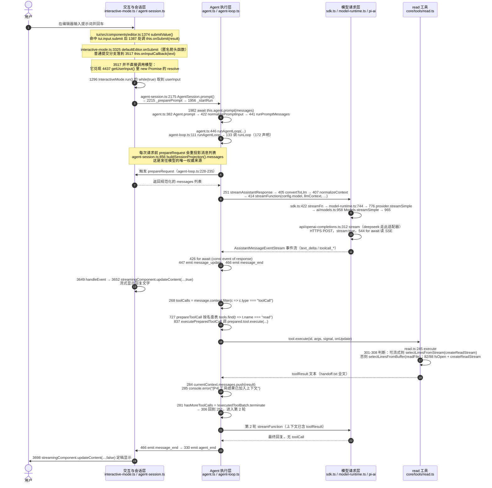
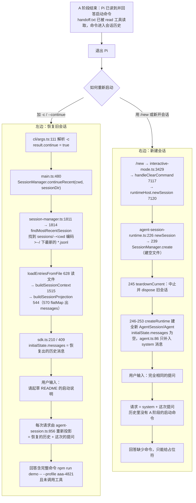

# 实践 05｜Pi Agent 源码泛读与功能定位

**姓名拼音：** yangsihui
**学号：** 202430224005
**小组仓库：** https://github.com/aaa-course-project/pi-hunnu-2026
**提交 commit：** `c3cc91632d0a1950fb122605b190233f2aa0006e`

> 文件名说明：课程文档要求提交 `practive-05.md`（原文缺一个 `c`）。本报告提交为 `practice-05.md` 以与其余报告保持一致；若教师要求严格按原文命名，请改名为 `practive-05.md`。

---

## A. 单轮交互与工具调用

### A.1 实验准备

在工作目录创建 `handoff.txt`，写入两行（`aaa-4821` 为本组随机生成的标识，提问中不透露命令）：

```text
待办：补充 README 的启动说明
启动命令：npm run demo -- --profile aaa-4821
```

### A.2 实际执行

启动本地构建的 Pi，在新会话中输入：

```text
请用 read 工具读取当前目录的 handoff.txt，原样告诉我待办和启动命令。
```

**实际终端记录（按发生顺序，stderr 与 stdout 合并）：**

```text
[P4] Agent 即将请求模型
[P4] 工具结果已加入上下文
[P4] Agent 即将请求模型
`handoff.txt` 内容原样如下：

待办：补充 README 的启动说明
启动命令：npm run demo -- --profile aaa-4821

(文件开头有一个 UTF-8 BOM 字符，其余文字如上。)
```

结果符合预期：发生了**一次** `read` 工具调用、**两轮**模型调用（对应实践课4 加的两行 `[P4]` 日志：第一条"即将请求模型"后出现"工具结果已加入上下文"，再出现第二条"即将请求模型"）。日志条数与工具实际执行次数一致。

> 说明：本次用打印模式（`-p`）取证，日志与交互模式同源（都走 `packages/agent` 的同一个循环），且便于逐行核对顺序。

### A.3 图 1：单轮工具调用的代码级时序图

以实际读取 `handoff.txt` 的那一轮为例。按职责划分五条生命线：用户、交互与会话层、Agent 执行层、模型请求层、`read` 工具。箭头标注的是真实的函数名或语句，跨文件调用用注释标出。



**图中几个容易画错的关键点（已逐一核对源码）：**

1. **提交不是直接调模型**。`onSubmit` → `onInputCallback` → 兑现 Promise → `run()` 的 `while(true)` 再调用 `session.prompt()`。中间隔着一个"输入泵"，少了这一步时序图就不对。
2. **发往模型的消息列表不是 `Agent` 的内存状态**。`agent-session.ts:856` 的 `buildSessionProjection().messages` 在每次请求前都会覆盖 `request.context.messages`，所以"恢复了哪些历史"取决于会话文件投影，而不是 `agent.state.messages`。
3. **`read` 工具是流式优先、缓冲兜底**：`read.ts:301-308` 用 `ops.createReadStream && isStreamableRange(offset, limit)` 判断；`defaultReadOperations` 里 `createReadStream: readLocalFileChunks`（68-73），内部 `fsOpen` 后 `handle.createReadStream({ end, autoClose: false })`（82/88）。图片则一律整文件 `ops.readFile`（277）。**不是** `Bun.file`。
4. **文件系统调用只发生在 `read` 工具里**，模型请求层看不到文件句柄，远程服务只收到工具返回的文本。

---

## B. 恢复上次会话，继续写 README

### B.1 恢复原会话（`-c`）

退出 Pi 后，在同一个项目目录用 `-c` 重新打开：

```powershell
node .\packages\coding-agent\dist\cli.js -c
```

输入：

```text
接着上次的待办，给 README 起草一条启动说明，写出交接单里的完整启动命令。只用这次会话已有的信息。不要调用工具。如果缺少命令，请直接说明。
```

**实际终端记录：**

```text
[P4] Agent 即将请求模型
README 启动说明草稿（仅基于本次会话的信息）：

## 启动

运行演示，指定 profile：

    npm run demo -- --profile aaa-4821

说明如下，需要注意的地方先说：

1. 交接单里只给出这一条完整命令 `npm run demo -- --profile aaa-4821`，没有说明 `demo` 脚本做什么……
2. 本次会话没有读过仓库的 README……
3. `handoff.txt` 开头有 BOM……

如果需要把这段扩成带前置步骤的完整说明，请告诉我 README 路径，或允许我读一下 `package.json` 的 `scripts` 字段来确认 `demo` 的实际行为。
```

**关键观察：**

- 回答里出现了**完整命令 `npm run demo -- --profile aaa-4821`**，而这次提问本身没有给出该命令
- 日志只有 **1 条**"Agent 即将请求模型"，**没有**"工具结果已加入上下文" → 本次**没有调用任何工具**
- 结论：命令来自**恢复的会话历史**（A 阶段 `read` 读到的内容），不是重新读文件

### B.2 新建会话（对照）

在同一个项目目录、同一个模型，用完全相同的提问，但不加 `-c`（等价于 `/new` 之后的新会话）：

**实际终端记录：**

```text
[P4] Agent 即将请求模型
没有可用的交接单内容。本次会话里没有任何历史待办、交接单文件或启动命令的记录（上下文是空的，也没有前置轮次），所以我无法写出"完整启动命令"——缺的就是这条命令本身。

如果直接起草，我只能给出占位符，例如：

## 启动

<在此填入交接单中的完整启动命令>

需要你补上交接单，或告诉我交接单文件的路径，我再去取命令。
```

**对比结果：**

| 对比项 | 恢复旧会话（`-c`） | 新建会话 |
|---|---|---|
| 提问 | 完全相同 | 完全相同 |
| 模型 | 同一个 | 同一个 |
| 是否出现在 A 阶段读到的命令 | **出现**（`npm run demo -- --profile aaa-4821`） | **没有**，只给占位符 |
| 是否调用工具 | 否（无"工具结果"日志） | 否 |
| 模型调用轮数 | 1 轮 | 1 轮 |
| 结论 | 用到了已恢复的会话历史 | 会话历史为空，只能承认缺信息 |

**会话文件证据：** 恢复行为依赖磁盘上的会话文件。本次 agent 目录下的 `sessions/` 实际存在如下 JSONL 文件（每次会话一个）：

```text
2026-11-26T09-11-12-598Z_01a2171f-89d6-735e-ac75-3f8a56b4606b.jsonl
2026-11-26T09-11-27-065Z_01a2171f-c259-741f-899d-c21a31678a51.jsonl
2026-11-26T09-11-35-450Z_01a2171f-e31a-7095-bd28-a0501a5f27ca.jsonl
2026-11-26T09-11-44-086Z_01a21720-04d5-746f-a984-ba03e511c958.jsonl
2026-11-26T09-12-00-096Z_01a21720-4360-710f-80b6-80dcb2fe577e.jsonl
```

`-c` 就是选其中**最近修改的一个**恢复。这也解释了为什么"退出再打开"能接着聊：历史不在内存里，而在这些文件里。

### B.3 图 2：恢复旧会话和新建会话的对照图

两条分支都从"A 阶段已结束、Pi 已读到并回答了启动命令"开始。



**图 2 的核心结论：**

- **恢复旧会话**：Pi 打开 A 阶段保存的会话文件 → 从文件恢复历史消息 → 用户提问 → **恢复出的历史消息 + 这次提问**一起用于请求模型，所以模型"记得"命令。
- **新建会话**：`/new` **不是**清空同一个 `Agent` 的历史，而是**换了一个新的会话**——新建空的 `SessionManager`，中止并 dispose 旧会话，再建全新的 `AgentSession`/`Agent`，其 `initialState.messages` 为空（`agent.ts:86` 只补入 system 消息）。所以请求里只有 system + 这次提问，历史里没有命令。

需要特别注意：代码里 `Agent.reset()` 确实存在（`agent.ts:364-377`），但 `/new` **没有调用它**——`packages/coding-agent/src` 下没有任何一处引用。所以"`/new` 就是 reset"这个理解是错的，它是**替换会话**。

---

## C. 附：本次用到的关键源码位置（便于核对）

| 环节 | 位置 |
|---|---|
| 编辑器提交 | `packages/tui/src/components/editor.ts:1374` `submitValue()`，1387 调 `onSubmit` |
| 提交处理 | `packages/coding-agent/src/modes/interactive/interactive-mode.ts:3325`（onSubmit 箭头函数），3517 `onInputCallback` |
| 输入泵 | 同文件 4437 `getUserInput()`，1296 `run()` 主循环 |
| 会话层入口 | `core/agent-session.ts:2175` `prompt()`，1956 `_startRun()`，1982 `agent.prompt()` |
| 请求消息投影 | `core/agent-session.ts:856` `buildSessionProjection().messages` |
| Agent 入口 | `packages/agent/src/agent.ts:382` `prompt()`，446 `runAgentLoop` |
| 循环 | `packages/agent/src/agent-loop.ts:111` `runAgentLoop`，172/251 `runLoop`/`streamAssistantResponse` |
| 模型调用点 | `agent-loop.ts:414` `streamFunction(...)`（`[P4]` 日志在 413） |
| 流式消费与事件 | `agent-loop.ts:426`（for await），447（message_update），466（message_end） |
| 工具分发 | `agent-loop.ts:268`、279、727、837 |
| 工具结果入上下文 | `agent-loop.ts:284`（`[P4]` 日志在 285） |
| read 工具 | `core/tools/read.ts:245` `execute`，301-308 流式/缓冲判定，82/88 `readLocalFileChunks` |
| provider 适配 | `core/model-runtime.ts:744/776`，`packages/ai/src/models.ts:958/965`，`api/openai-completions.ts:312` |
| 回复渲染 | `interactive-mode.ts:3649/3652`（message_update），3685/3698（message_end） |
| `-c` 解析与恢复 | `cli/args.ts:111`，`main.ts:480`，`core/session-manager.ts:1811/1814/628/1515/544` |
| `/new` | `interactive-mode.ts:3429/7117`，`core/agent-session-runtime.ts:226/239/245` |

---

## 提交信息

- 个人报告仓库：`https://github.com/Yes-ysh/pi-hunnu-2026-assignments`
- 小组代码仓库：`https://github.com/aaa-course-project/pi-hunnu-2026`
